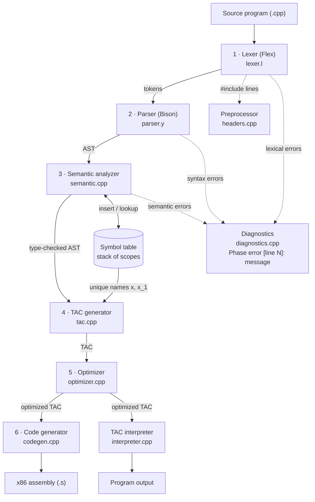
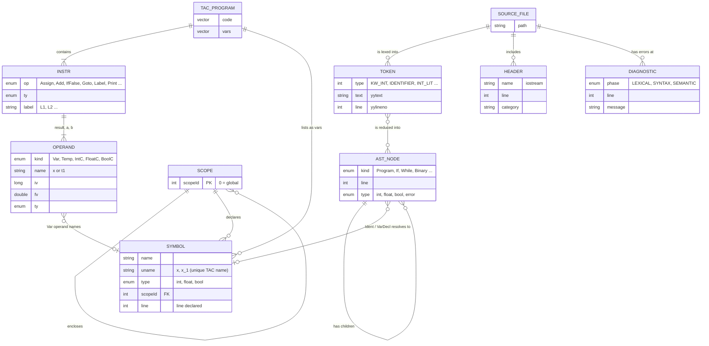
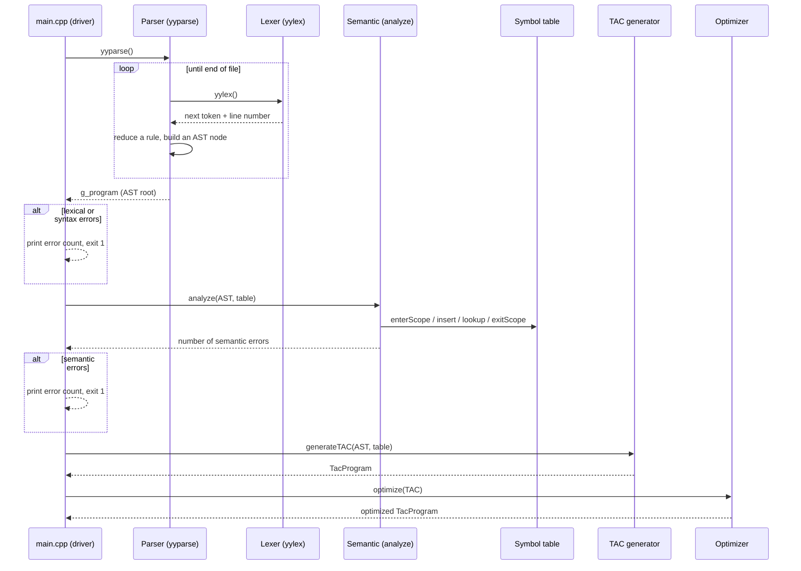
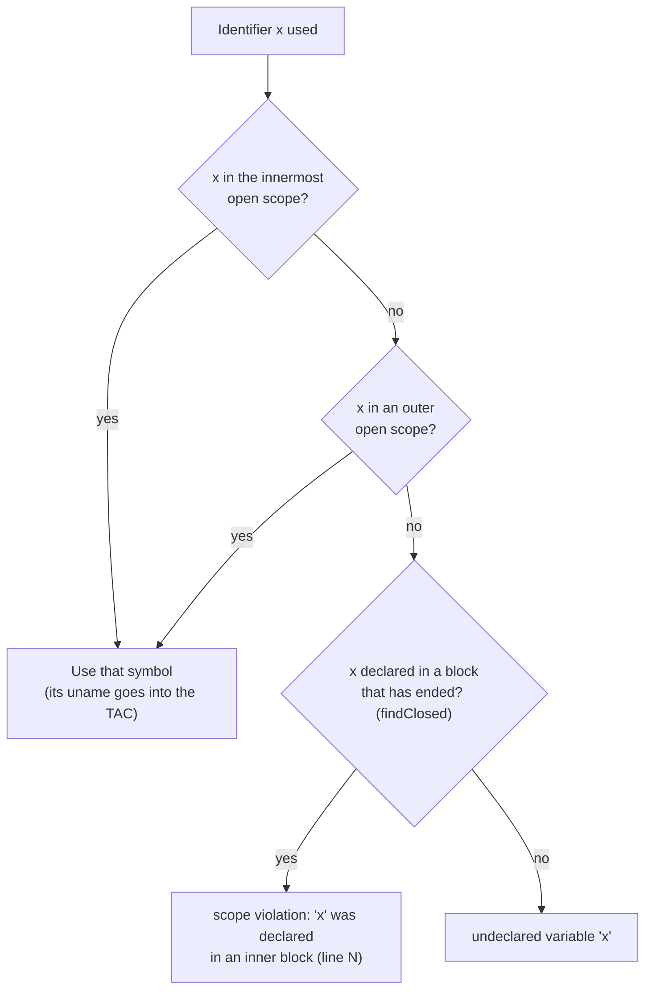
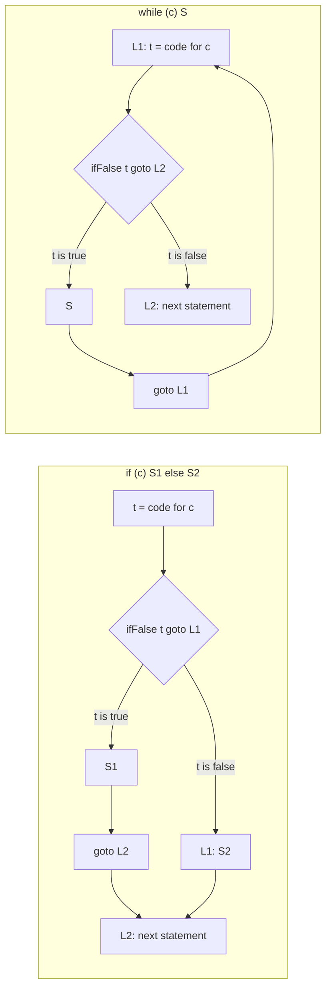

# Tricora Compiler - C++ version

Compiler for a C++-style mini language, built with **Flex** and **Bison** and written in **C++**.
Part of the Compiler Construction Lab project (Metropolitan University, Bangladesh).
Branch: `c++_compiler` — Developer: Abdul Julil Shahria (C++ compiler and UI).

---

## 1. What is in this compiler

The compiler reads a source program and passes it through **six phases**:

```
source.cpp
   |
   v
[1] Lexical analysis ----> tokens
   |
   v
[2] Syntax analysis -----> AST (abstract syntax tree)
   |
   v
[3] Semantic analysis ---> checked AST + symbol table
   |
   v
[4] Intermediate code ---> Three Address Code (TAC)
   |
   v
[5] Optimization --------> optimized TAC
   |
   v
[6] Code generation -----> x86 assembly  (+ interpreter runs the program)
```

| # | Phase | What it does | Files |
|---|---|---|---|
| 1 | Lexical analysis | Turns characters into tokens, drops comments and whitespace, reports invalid characters, bad identifiers and unterminated comments. Also reads `#include` lines. | `src/lexer/lexer.l`, `src/preprocessor/headers.*` |
| 2 | Syntax analysis | Checks the grammar with Bison, builds the AST, recovers from errors so several syntax errors can be reported in one run. | `src/parser/parser.y`, `src/ast/ast.h`, `src/ast/ast.cpp` |
| 3 | Semantic analysis | Uses a nested-scope symbol table to find undeclared variables, redeclarations, scope violations, type mismatches, invalid assignments and invalid operands. | `src/semantic/semantic.*`, `src/symbol_table/symbol_table.*` |
| 4 | Intermediate code | Generates Three Address Code with temporaries (`t1`, `t2`, ...) and labels (`L1`, `L2`, ...). | `src/tac/tac.*` |
| 5 | Optimization | Constant folding and propagation, dead-temporary removal, unreachable-code removal, jump cleanup. | `src/optimizer/optimizer.*` |
| 6 | Code generation | Produces 32-bit x86 assembly (AT&T syntax, MinGW). A TAC interpreter can also run the program directly. | `src/codegen/codegen.*`, `src/codegen/assembly.*`, `src/interpreter/interpreter.*` |

Other files: `src/main.cpp` (driver), `src/common/` (types and error reporting), `Makefile`, `ui/compiler_ui.py` (GUI).

---

## 2. Diagrams

GitHub draws these diagrams from the Mermaid code below.

### 2.1 Compiler architecture

Each phase reads the output of the one before it. The driver (`src/main.cpp`) stops after any phase that reports an error.



### 2.2 ER diagram (data model)

The data structures the phases create, and how they relate. `SCOPE` has no struct of its own: it is the `scopeId` number in `Symbol` plus one map on the symbol table's scope stack.



### 2.3 AST class diagram

Every node derives from `Node` (`src/ast/ast.h`). The first group is the manual's core language; the second is the C++ syntax on top of it.

```mermaid
classDiagram
    class Node {
        <<abstract>>
        +NodeKind kind
        +int line
        +Type type
        +print(os, indent)
    }
    class BlockNode {
        +vector~Node~ stmts
    }
    class VarDeclNode {
        +Type declType
        +string name
        +string uname
        +Node init
    }
    class AssignNode {
        +string name
        +string uname
        +Node value
    }
    class IfNode {
        +Node cond
        +Node thenStmt
        +Node elseStmt
    }
    class WhileNode {
        +Node cond
        +Node body
        +Node step
    }
    class PrintNode {
        +Node expr
    }
    class BinaryNode {
        +string op
        +Node left
        +Node right
    }
    class UnaryNode {
        +string op
        +Node operand
    }
    class IdentNode {
        +string name
        +string uname
    }
    class IntLitNode {
        +long value
    }
    class FloatLitNode {
        +double value
    }
    class BoolLitNode {
        +bool value
    }
    class DoWhileNode {
        +Node body
        +Node cond
    }
    class SwitchNode {
        +Node expr
        +vector~SwitchCase~ cases
    }
    class JumpNode {
        break or continue
    }
    class ReturnNode {
        +Node value
    }
    class TernaryNode {
        +Node cond
        +Node a
        +Node b
    }
    class CoutNode {
        +vector~CoutItem~ items
    }
    class CinNode {
        +vector~IdentNode~ vars
    }

    Node <|-- BlockNode
    Node <|-- VarDeclNode
    Node <|-- AssignNode
    Node <|-- IfNode
    Node <|-- WhileNode
    Node <|-- PrintNode
    Node <|-- BinaryNode
    Node <|-- UnaryNode
    Node <|-- IdentNode
    Node <|-- IntLitNode
    Node <|-- FloatLitNode
    Node <|-- BoolLitNode
    Node <|-- DoWhileNode
    Node <|-- SwitchNode
    Node <|-- JumpNode
    Node <|-- ReturnNode
    Node <|-- TernaryNode
    Node <|-- CoutNode
    Node <|-- CinNode
    BlockNode o-- "0..*" Node : stmts
```



### 2.4 Phase sequence

How the driver calls the phases. The lexer does not run on its own: Bison calls `yylex()` each time it needs the next token.



### 2.5 Identifier lookup (semantic analysis)

How the semantic analyzer decides between "found", "undeclared variable" and "scope violation".



### 2.6 TAC patterns for control flow

`if-else` and `while` become labels and jumps (`src/tac/tac.cpp`).



---

## 3. The language

**Core language** (fixed by the lab manual):

- Types: `int`, `float`, `bool`
- Declarations: `int x;` and `int x = 5;`
- Assignment: `x = 5;`
- Operators: arithmetic `+ - * / %`, relational `< > <= >= == !=`, logical `&& || !`, unary `-`
- Statements: `if`, `if-else`, `while`, `print`, nested blocks `{ ... }` with proper scoping
- Literals: integers, floats (`3.14`), `true`, `false`
- Comments: `// ...` and `/* ... */`
- `int` can be used where `float` is expected (widening). Every other mix is an error.

**C++ syntax on top of the core** (ordinary beginner C++ programs run, and so does the manual's style):

- `int main() { ... return 0; }` (also `int main(void)`). **Every program must define `int main()`**, and outside it only variable declarations are allowed, as in real C++
- Output: `cout << a << "text" << endl;` (also `std::cout`, `'\n'`, `"\n"`). Like real C++, `cout` adds no newline and prints a `bool` as `1`/`0`. The manual's `print x;` still prints the value and a newline, with `true`/`false`.
- Input: `cin >> a >> b;` for `int`, `float`/`double` and `bool`
- Loops: `for`, `while`, `do { ... } while (cond);`, with `break` and `continue`
- `switch (n) { case 1: ... break; case 2: case 3: ... default: ... }` (int `case` values, fall-through works)
- `cond ? a : b` for numbers and bools, and `cout << (cond ? "yes" : "no")` for text
- `return expr;` inside `main` (jumps to the end of the program)
- Declarations: `int a, b = 2;`, `const int N = 5;`
- Type names: `double` is treated as `float`, and `long`, `long long`, `short` as `int`
- Shorthand: `x++`, `x--`, `++x`, `--x`, `x += e`, `x -= e`, `x *= e`, `x /= e`
- Numbers: `3.14`, `.5`, `2.`, `1e3`; text and character literals with `\n \t \\ \"` escapes (only as `cout` items)
- `#include <...>` headers and `using namespace std;`

**Headers.** All standard C++ headers (`<iostream>`, `<vector>`, `<cmath>`, ... up to C++23), classic C headers such as `<stdio.h>`, and `<bits/stdc++.h>` are accepted and listed. Only `<iostream>` has an effect: `cout` needs it. An unknown header or a quoted `"file.h"` is a lexical error.

**Header rules**

- Every program must start with `#include <iostream>`. Without it the compiler reports `missing required header` on line 1.
- `#include` lines must be at the top of the file, before any code. A later `#include` is a lexical error.
- `--allow-no-header` switches the first rule off.

**Main-function rules**

- Without `int main() { ... }` the compiler reports `program has no 'int main()' function`.
- Statements outside `main` (other than variable declarations) are an error: `statement outside of main()`.
- `void main()`, `main()` with no type, a second `main`, and a missing `{ }` are each reported.
- `--allow-no-main` switches these rules off. **`--manual` switches off both the header rule and the main rule**, so the lab manual's sample (no header, no `main`) still compiles:
  `build/compiler.exe --manual --run examples/sample.cpp`

The formal grammar is in [`docs/grammar.md`](docs/grammar.md).

---

## 4. Requirements

- `g++` (C++11 or newer), `flex`, `bison`, `make`
- On Windows: MinGW with MSYS, run commands in **Git Bash**
- Python 3 with Tkinter (only for the GUI)

Tested with MinGW GCC 6.3, Flex 2.5.35, Bison 2.4.2, GNU Make 3.81.

---

## 5. How to build and run

Run everything from the compiler folder (`backend/c++_compiler` inside the repository):


```bash
cd backend/c++_compiler
```

**Build**

```bash
make
```

This creates `build/compiler.exe`. Use `make clean` to start from scratch.

**Compile a program** (prints Three Address Code by default)

```bash
build/compiler.exe examples/headers_demo.cpp
```

**Show a single phase**

| Flag | Output |
|---|---|
| `--headers` | `#include` headers found |
| `--tokens` | token stream (phase 1) |
| `--ast` | indented syntax tree (phase 2) |
| `--symtab` | symbol table: name, type, scope, line (phase 3) |
| `--tac` | three address code (phase 4), default |
| `--opt` | optimized TAC (phase 5) |
| `--asm` | x86 assembly (phase 6) |
| `--run` | execute the program with the interpreter |
| `--all` | everything above |
| `-o file.s` | write the assembly to a file |
| `--manual` | do not require `#include <iostream>` or `int main()` (the manual's program style) |

```bash
build/compiler.exe --manual --all examples/sample.cpp
build/compiler.exe --opt --run examples/floats.cpp
```

**Make a real executable** (MinGW `gcc` assembles the generated code)

```bash
build/compiler.exe --manual -o build/out.s examples/sample.cpp
gcc build/out.s -o build/out.exe
build/out.exe
```

**GUI**

```bash
python ui/compiler_ui.py
```

Type or open a program, press **Compile & Run**, and read each phase in its own tab (Headers, Tokens, AST, Symbol Table, TAC, Optimized TAC, Assembly, Output, Errors).

**Tests**

```bash
make test
```

Runs every program in `tests/` and compares the result with its `.expected` file. Use `bash tests/run_tests.sh --update` to regenerate the expected files after an intended change (check them with `git diff`).

---

## 6. Example

Input (`examples/sample.cpp`, the manual's sample; compile it with `--manual`):

```cpp
int x;
int y;
bool flag;

x = 10;
y = 0;
flag = true;

while (x > 0) {
   y = y + x;
   x = x - 1;
}

if (flag == true) {
   print y;
} else {
   print x;
}
```

Optimized TAC (`--opt`):

```
    x = 10
    y = 0
    flag = true
L1:
    t1 = x > 0
    ifFalse t1 goto L2
    y = y + x
    x = x - 1
    goto L1
L2:
    t4 = flag == true
    ifFalse t4 goto L3
    print y
    goto L4
L3:
    print x
L4:
```

Program output (`--run`): `55`

Error example (`tests/semantic/invalid_expression.cpp`):

```
Semantic error [line 3]: invalid operands to '&&': int and bool (logical operators need bool operands)
Semantic error [line 4]: invalid operand to '!': int (needs bool)
Semantic error [line 8]: condition of 'if' must be bool, found int
Compilation failed: 6 semantic error(s).
```

---

## 7. Errors the compiler reports

| Kind | Examples |
|---|---|
| Lexical | invalid character `@`, identifier starting with a digit (`2abc`), unterminated `/*` comment, unknown header |
| Syntax | missing `;`, unbalanced parentheses or braces (reported with line number, parsing continues) |
| Semantic | undeclared variable, redeclaration in the same scope, use outside its scope, type mismatch (`bool b = 5 + 3.2;`), invalid assignment (`int x = true;`), invalid operands (`&&` on numbers, `%` on floats), non-bool `if`/`while` condition, `cout` without `<iostream>` |

Compilation stops before the next phase if the current one found errors.

---

## 8. Project layout

All C++ compiler files live in `backend/c++_compiler/`:

```
src/
  lexer/         lexer.l
  parser/        parser.y
  ast/           ast.h, ast.cpp
  symbol_table/  symbol_table.h, symbol_table.cpp
  semantic/      semantic.h, semantic.cpp
  tac/           tac.h, tac.cpp
  optimizer/     optimizer.h, optimizer.cpp
  codegen/       codegen.h/.cpp, assembly.h/.cpp
  interpreter/   interpreter.h, interpreter.cpp
  preprocessor/  headers.h, headers.cpp
  common/        types.h, diagnostics.h/.cpp
  main.cpp
tests/           valid/, lexical/, syntax/, semantic/ (program + .expected) and run_tests.sh
examples/        sample programs
docs/            grammar.md
ui/              compiler_ui.py
Makefile
```

`build/` holds generated files (`lex.yy.cpp`, `parser.tab.cpp`, object files, `compiler.exe`) and is not committed.

---

## 9. Limitations

- Only the language described in section 3. **Not supported yet:** functions other than `main`, arrays, pointers, `std::string` variables, `char` variables, classes/structs, `unsigned`, `goto`, `#define`. A program using them stops with a syntax error.
- Text can only be written with `cout` (including `cout << (cond ? "yes" : "no")`); it cannot be stored in a variable.
- `double` has the same precision as `float` in the generated assembly (the interpreter uses full doubles).
- The assembly targets 32-bit MinGW on Windows. It uses `_main` and `_printf` names, so it will not assemble unchanged on Linux.
- Other headers are accepted but have no library functions behind them.
- `&&` and `||` evaluate both sides (the language has no side effects, so results are the same).
